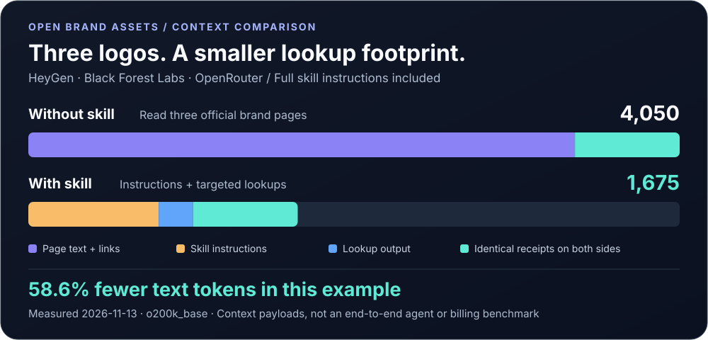

<div align="center">

# Open Brand Assets

### Real logos for coding agents. More room for the work that matters.

Find existing brand artwork, choose a supplied variant, and save it to your project with its source attached.

[](https://github.com/lxf82dev/open-brand-assets/actions/workflows/check.yml)
[](#eleven-collections-one-lookup)
[](#use-the-cli)
[](LICENSE)

[Install the skill](#install-the-skill) · [Token comparison](#token-comparison) · [Browse the logos](#our-complementary-collection) · [Credits](#credits-to-the-people-building-the-commons) · [Contribute](#help-fill-the-next-gap)

</div>

Your agent is building an integration grid, a provider picker, a landing page, or a slide. It needs the right logos. Finding files, checking variants, and retracing their sources can take more context than the UI itself.

**Open Brand Assets gives the agent a repeatable lookup and retrieval workflow.** Python searches our collection and ten established open-source catalogs. The model reads matching results; image bytes are saved to disk. Each file in our collection has a source URL, date, variant, usage note, and SHA-256.



*Measured three-logo example, including skill instructions. [See the breakdown and limits](#token-comparison).*

## Install the skill

```bash
npx skills add lxf82dev/open-brand-assets --skill find-brand-logo
```

Then ask your coding agent:

> Use find-brand-logo to add the OpenRouter ink glyph to `public/logos/`. Keep lookup output small and include its source and usage notes.

The [skill](skills/find-brand-logo/SKILL.md) is self-contained. It reads our public GitHub catalog when installed alone and the local catalog in a full checkout. The [Skills CLI](https://github.com/vercel-labs/skills) lets you choose your supported coding agent and needs Node.js 22.20+. Alternatively, copy `skills/find-brand-logo/` into your agent's supported skills directory.

**The logo helper needs only Python 3.10+. No API keys, Python packages, or account required.** The optional token benchmark below has its own tokenizer dependency.

## Why this helps coding agents

| What the agent needs | What this project provides |
| --- | --- |
| A real asset for a named company or product | Search across eleven existing collections, with aliases in our catalog. |
| A small amount of relevant context | Filter catalogs in Python and return a limited set of matches. |
| A file ready to place in a project | Retrieve an exact local-catalog variant; verify its hash and format. |
| Enough context to choose correctly | Named variants, light/dark hints where supplied, source dates, and available guideline links. |
| A way to revisit or update the choice | Original download URLs, provenance, checksums, and commit-pinned GitHub upstream results. |
| A missing brand or current official variant | A complementary collection and an open contribution workflow. |

### Keep lookup context small

1. **Know the brand and variant? Fetch directly.** No discovery round trip is needed.
2. **Know we carry the brand? Use `--source ours --limit 1`.** Widen the result limit when you need more variants.
3. **Need broader coverage? Search all eleven with `--limit 1`.** The limit is per source, so this returns at most eleven matches.
4. **Use plain-text output for a quick shortlist.** Add `--json` when you need structured metadata and source-status details.
5. **Write image bytes to a file.** Keep SVG markup, base64 images, and whole catalog dumps out of the model's context.

Public catalogs are cached for 24 hours. That avoids repeated network downloads; it does not reduce tokens if the same text is returned to the model again. Use `--refresh` when you need a fresh catalog lookup. Inspect the artwork and current official guidance when the intended use requires it.

## Token comparison

**Measured example: retrieve one supplied logo variant each for HeyGen, Black Forest Labs, and OpenRouter.** Compare reading the three known official brand pages with targeted lookups in our known catalog coverage.

| Counted text | Without skill: read brand pages | With skill: targeted lookups |
| --- | ---: | ---: |
| Readable official-page text + unique asset URLs | 3,399 | — |
| Complete skill instructions, loaded once | — | 906 |
| Three plain-text lookups, one match each | — | 213 |
| Same three source/hash/usage receipts | 651 | 651 |
| **Total context-text tokens** | **4,050** | **1,770** |

**2,280 fewer context-text tokens (56.3%) in this example.** Counted on 2026-11-13 with `tiktoken==0.12.0`, `o200k_base`. The baseline excludes raw HTML, scripts, navigation, and SVG contents. Image bytes stay on disk in both scenarios.

This is a controlled text-payload comparison, **not an end-to-end agent run or billing benchmark**. It excludes reasoning/output, message envelopes, installation, visual inspection, and any additional policy review. A precise page extraction or custom script can match or beat this result. Different brands, tokenizers, broader searches, and full JSON outputs change the counts; official pages can change too.

See the [measurement and source hashes](research/token-benchmark.json) and [methodology](research/TOKEN_BENCHMARK.md), or [run the measurement script](scripts/benchmark_tokens.py). The claim is that filtering can keep context small; it is not a claim of the lowest possible token use for every agent.

## Eleven collections, one lookup

| Collection | What it brings |
| --- | --- |
| **[Open Brand Assets](catalog.json)** | Our complementary files with dated provenance, variants, usage notes, and checksums. |
| **[SVGL](https://github.com/pheralb/svgl)** | Color logos, wordmarks, theme variants, and brand-guideline links where supplied. |
| **[Lobe Icons](https://github.com/lobehub/lobe-icons)** | AI model, provider, and application artwork. |
| **[Simple Icons](https://github.com/simple-icons/simple-icons)** | Monochrome icons across a broad range of brands. |
| **[theSVG](https://github.com/glincker/thesvg)** | Brand and cloud-service artwork with multiple variants. |
| **[Gilbarbara Logos](https://github.com/gilbarbara/logos)** | Optimized developer and DevOps logos, including named variants and shortname aliases. |
| **[Vector Logo Zone](https://github.com/VectorLogoZone/vectorlogozone)** | Standardized brand icons, tiles, and horizontal marks. |
| **[Devicon](https://github.com/devicons/devicon)** | Programming languages and developer/design tools, including alternate names. |
| **[selfh.st Icons](https://github.com/selfhst/icons)** | Self-hosted application and service logos, with collection attribution retained. |
| **[Dashboard Icons](https://github.com/homarr-labs/dashboard-icons)** | Dashboard and homelab service artwork, including PNG-only assets. |
| **[Cryptocurrency Icons](https://github.com/spothq/cryptocurrency-icons)** | Currency names and symbols, such as Bitcoin/BTC, in four supplied styles. |

These communities built the breadth. We add a shared agent workflow, a complementary collection, and source records for our files. The adapters link to their assets without mirroring their collections. See [upstream credits and contributors](#credits-to-the-people-building-the-commons).

Source failures stay visible instead of being treated as zero matches. JSON output includes lookup time, cache status, match counts, and source errors. GitHub upstream asset URLs are pinned to the retrieved commit; GitHub's public API rate limits can apply. Names can collide, so confirm the company or product behind a match.

Use `--source` to target a collection: `ours`, `svgl`, `lobe`, `simple-icons`, `thesvg`, `gilbarbara`, `vectorlogozone`, `devicon`, `selfhst`, `dashboard-icons`, or `crypto`. selfh.st and Dashboard Icons prefer SVG and include PNG when a matching SVG is unavailable. Required selfh.st attribution and Vector Logo Zone rights notes appear in plain text as well as JSON. Repository licenses describe the projects; individual brand rights remain separate.

See the [additional-source research](research/ADDITIONAL_SOURCES.md) for the integration decisions and verified examples. Coverage overlaps across collections; their asset counts are not a count of unique brands.

## Use the CLI

```bash
git clone https://github.com/lxf82dev/open-brand-assets.git
cd open-brand-assets

# Direct retrieval when you already know the supplied variant.
python3 logos.py fetch openrouter --variant glyph-ink --output ./public/logos/openrouter.svg

# Small shortlist from our catalog.
python3 logos.py search "HeyGen" --source ours --limit 1

# Broaden to all eleven collections: at most one match per source.
python3 logos.py search "Claude" --limit 1

# Full metadata when you need it.
python3 logos.py search "OpenRouter" --limit 1 --json

# Target specialized coverage and aliases.
python3 logos.py search "arm64" --source devicon --limit 1
python3 logos.py search "Bitcoin" --source crypto --limit 1

# Full-checkout use without network access.
python3 logos.py search "LibTV" --offline --limit 1
```

`fetch` handles our catalog's exact variants, checks the SHA-256 and supported image content, prints provenance and usage notes, and refuses to overwrite an existing file without `--force`. For upstream candidates, download the returned URL and preserve the applicable notices. `--offline` uses only a full checkout's local catalog and files.

The [public catalog](catalog.json) is generated from `brands/*/brand.json`. For reproducible builds, pin a commit when consuming assets directly:

```text
https://raw.githubusercontent.com/lxf82dev/open-brand-assets/<commit>/brands/openrouter/glyph-ink.svg
```

## Our complementary collection

**39 files across eight brands**, collected on 2026-11-13.

| Brand | Included files | Original source |
| --- | --- | --- |
| [HeyGen](brands/heygen/) | 15 SVGs: symbol, full, secondary, and tertiary lockups | [Official brand kit](https://www.heygen.com/brand-kit) |
| [Higgsfield](brands/higgsfield/) | Website and touch icons, PNG | [Official website](https://higgsfield.ai/) |
| [Runware](brands/runware/) | Website icon and white wordmark, SVG | [Official website](https://runware.ai/) |
| [LibTV](brands/libtv/) | Website touch icon, PNG | [Official website](https://www.liblib.tv/) |
| [Black Forest Labs](brands/black-forest-labs/) | Black/white symbol and logotype, SVG | [Official brand page](https://bfl.ai/brand) |
| [OpenRouter](brands/openrouter/) | Glyph, horizontal, and vertical in four colorways, SVG | [Official brand page](https://openrouter.ai/brand) |
| [Stitchable](brands/stitchable/) | Owner-supplied color and mono glyphs, SVG | [Stitchable](https://stitchable.ai/) |
| [EditableFrames](brands/editableframes/) | Owner-supplied app icon, SVG | [EditableFrames](https://editableframes.stitchable.ai/) |

Six brands had no matching brand paths in the original four upstream catalogs recorded in our [upstream coverage snapshot](research/upstream-coverage.json): HeyGen, Higgsfield, Runware, LibTV, Stitchable, and EditableFrames. This is a dated filename/alias check, not an exhaustive absence claim. BFL and OpenRouter already have upstream coverage; our entries provide official downloads and dated source records.

Files are preserved byte-for-byte. HeyGen's three official symbol SVGs embed PNG artwork and are labelled accordingly. Website icons are labelled `site-icon`. Source dates record collection or checking, not a guarantee that a vendor has kept the same identity since.

## Credits to the people building the commons

Thank you to the maintainers and contributors who collect, verify, update, and share these assets. Their work makes the cross-collection workflow possible. Please visit their repositories, support their maintainers, and contribute improvements upstream where appropriate.

| Project | Maintainers and contributors | What we use or learn from |
| --- | --- | --- |
| [SVGL](https://github.com/pheralb/svgl) | [Pablo Hdez / pheralb](https://github.com/pheralb) and [SVGL contributors](https://github.com/pheralb/svgl/graphs/contributors) | Public catalog lookup, SVG-first assets, variants, and brand-guideline metadata. |
| [Lobe Icons](https://github.com/lobehub/lobe-icons) | [LobeHub](https://github.com/lobehub) and [Lobe Icons contributors](https://github.com/lobehub/lobe-icons/graphs/contributors) | AI-brand coverage and static SVG variants. |
| [Simple Icons](https://github.com/simple-icons/simple-icons) | The [Simple Icons community](https://github.com/simple-icons) and [its contributors](https://github.com/simple-icons/simple-icons/graphs/contributors) | Monochrome brand coverage, source metadata, and contribution practices. |
| [theSVG](https://github.com/glincker/thesvg) | [glincker](https://github.com/glincker) and [theSVG contributors](https://github.com/glincker/thesvg/graphs/contributors) | Broad brand/cloud coverage and variant discovery. |
| [Gilbarbara Logos](https://github.com/gilbarbara/logos) | [gilbarbara](https://github.com/gilbarbara) and [Logos contributors](https://github.com/gilbarbara/logos/graphs/contributors) | Optimized artwork and brand/variant metadata. |
| [Vector Logo Zone](https://github.com/VectorLogoZone/vectorlogozone) | [VectorLogoZone](https://github.com/VectorLogoZone) and [its contributors](https://github.com/VectorLogoZone/vectorlogozone/graphs/contributors) | Consistent layouts and official-source records. |
| [Devicon](https://github.com/devicons/devicon) | The [Devicons community](https://github.com/devicons) and [Devicon contributors](https://github.com/devicons/devicon/graphs/contributors) | Developer-tool artwork and alternative names. |
| [selfh.st Icons](https://github.com/selfhst/icons) | [selfh.st](https://selfh.st/) and [Icons contributors](https://github.com/selfhst/icons/graphs/contributors) | Self-hosted application coverage; collection attribution under CC-BY-4.0. |
| [Dashboard Icons](https://github.com/homarr-labs/dashboard-icons) | [Homarr Labs](https://github.com/homarr-labs) and [Dashboard Icons contributors](https://github.com/homarr-labs/dashboard-icons/graphs/contributors) | Dashboard and homelab application artwork. |
| [Cryptocurrency Icons](https://github.com/spothq/cryptocurrency-icons) | [Spot](https://github.com/spothq), original creator [Christopher Downer](https://github.com/cjdowner), and [contributors](https://github.com/spothq/cryptocurrency-icons/graphs/contributors) | Currency artwork, symbols, and name metadata. |
| [Skills CLI](https://github.com/vercel-labs/skills) | [Vercel Labs](https://github.com/vercel-labs) and [Skills contributors](https://github.com/vercel-labs/skills/graphs/contributors) | Installation and discovery of the reusable agent skill. |
| [tiktoken](https://github.com/openai/tiktoken) | [OpenAI](https://github.com/openai) and [tiktoken contributors](https://github.com/openai/tiktoken/graphs/contributors) | Token counting for the optional, reproducible comparison. |

Thanks also to the brand owners publishing their official artwork and guidelines, linked in the collection above, and to [this repository's contributors](https://github.com/lxf82dev/open-brand-assets/graphs/contributors). These acknowledgments do not imply affiliation or endorsement. Upstream code and artwork remain under their respective terms.

## Help fill the next gap

Bring a missing brand, a new official identity, a better source, or a correction to usage metadata. Follow [CONTRIBUTING.md](CONTRIBUTING.md), [request a logo](https://github.com/lxf82dev/open-brand-assets/issues/new?template=logo-request.yml), or [report a correction](https://github.com/lxf82dev/open-brand-assets/issues/new?template=correction.yml).

```bash
python3 scripts/catalog.py
python3 scripts/catalog.py --check
python3 -m unittest discover -s tests -v
```

CI checks file hashes, source metadata, supported image content, and the generated catalog without network access.

## License and brand rights

Our original code, documentation, and skill are [MIT licensed](LICENSE). **Brand images retain their owners' rights and are excluded from that grant.** A public download or open-source collection license does not establish permission for every use or redistribution. Consult each manifest and [TRADEMARKS.md](TRADEMARKS.md) for the recorded conditions and official sources.
